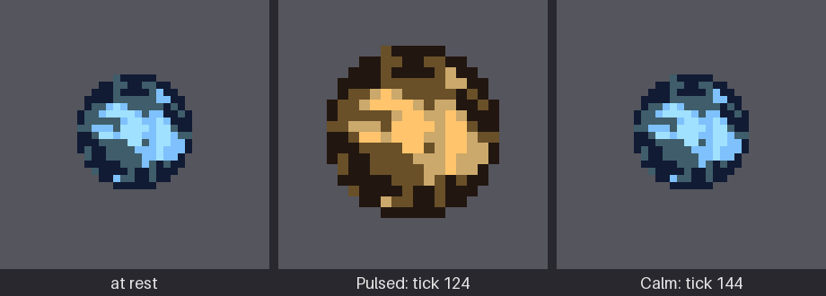
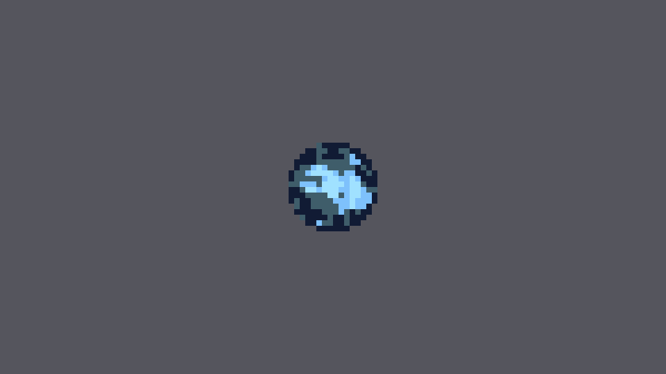
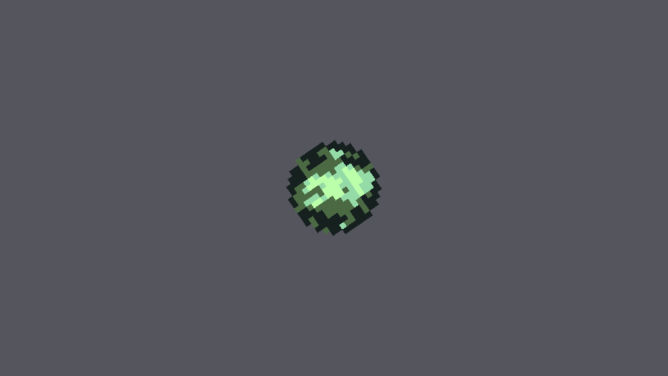

# An introduction to Korvid

Build a small game from nothing, one engine idea at a time: a module, then a window, then
the frame loop that runs it, a sprite, a system the scheduler places, and events and timers
that make the sprite answer the keyboard. Every step builds and runs, and each one shows
what the engine prints or draws.

The game is [hello](../../examples/hello/README.md): a ball in a window. The arrow keys
steer it, and Space makes it pulse large and orange for a third of a second.



You need the engine built once, as [the project README](../../README.md#quick-start)
describes, and `kormake` on your path. To put it there, run
`tools/kormake/bin/linux/kormake link tools` from the engine once (`macos` or `windows` for
those hosts). The `kormake` and the tools you then type are always the ones of the engine
your directory builds against ([linked tools](../../tools/kormake/README.md#linked-tools)).
The guide assumes C++ and nothing about the engine.

**To type it in as you go**, make a directory beside the engine (`~/code/mygame/` next to
`~/code/korvid/`) with a one-line `korvid.config` that says where the engine is:

```lua
engine "../korvid"
```

and put the module in `~/code/mygame/hello/`. The engine's own examples are hidden from a
project like this one, so your `hello` and the finished one in `examples/hello/` never
meet. Build and run from `~/code/mygame/`; the program lands in `build/linux-debug/bin/`
there.

The finished files are in `examples/hello/`. The code below is quoted from them, or is an
earlier stage of them.

## 1. A module

Everything in Korvid is a module: the window, the renderer, sprites, the frame loop, and
your game. A module is a directory with a `module.lua`, and in code one `ModuleDesc`
record that tells the engine what the module brings. Start with a module that brings only
a startup and a shutdown.

```
hello/
  module.lua                     the module's name, what it needs, and that it is a program
  include/korvid/hello/module.h  declares the record, so main can link it
  src/game.cc                    the record and the code
  src/main.cc                    main: the config and one call
```

```lua
module "hello" {
  output        = "exe",
  engine_module = true,
  deps          = { "core", "frameloop" },
}
```

`deps` names the modules this one uses. `frameloop` is the mechanical part of every game:
the command line, the window, the renderer, the loop. It has dependencies of its own, and
kormake follows them all, puts every module in dependency order, and generates the list
the program starts from.

```cpp
// include/korvid/hello/module.h
#pragma once
#include "korvid/core/module.h"

namespace kv {
KV_MODULE_DECLARE(hello_module);
}
```

```cpp
// src/game.cc
#include "korvid/hello/module.h"
#include "korvid/core/log.h"

namespace kv {
namespace {

bool hello_startup(Engine&, ModuleInstance&) {
    KV_INFO("hello", "hello, engine");
    return true;
}

void hello_shutdown(Engine&, ModuleInstance&) {
    KV_INFO("hello", "goodbye");
}

} // namespace

KV_MODULE_DEFINE(hello_module) = {
    .name     = "hello",
    .startup  = hello_startup,
    .shutdown = hello_shutdown,
};

} // namespace kv
```

`main.cc` is the same in every game: a `FrameLoopConfig` and one call. This one is
`examples/hello/src/main.cc` as it stays to the end:

```cpp
#include "korvid/frameloop/frameloop.h"

namespace {
constinit const kv::FrameLoopConfig k_config = {
    .title  = "hello, korvid",
    .width  = 960,
    .height = 540,
};
}

int main(int argc, char** argv) { return kv::frameloop_main(argc, argv, k_config); }
```

Build it and run it, from the engine's root:

```bash
kormake hello
```

```bash
build/linux-debug/bin/hello
```

A window opens, empty:


The log says what happened. `frameloop_main` read the generated list, and `engine_init`
started every module in it, in order:

```
[ INFO] engine: module 'platform' up
[ INFO] engine: module 'platform_hid' up
[ INFO] engine: module 'renderer-vulkan' up
[ INFO] engine: module 'renderer-cpu' up
[ INFO] engine: module 'asset' up
...
[ INFO] engine: module 'touchpad' up
[ INFO] window: opened 'hello, korvid' 960x540 px
[ INFO] engine: module 'frameloop' up
[ INFO] hello: hello, engine
[ INFO] engine: module 'hello' up
```

```
 module.lua               kormake                       engine_init
 deps = { core,    ──▶    every dependency,      ──▶    reads each ModuleDesc,
          frameloop }     in order: platform,           builds the schedule,
                          platform_hid, renderer,       runs each startup in order;
                          asset, sprite, ...,           engine_shutdown runs the
                          frameloop, hello              shutdowns in reverse
```

You named two modules, and thirteen started. You never opened the window: `frameloop`
opened it in its own startup, through `platform_hid`. Your startup runs
last, so everything it might want is already up. Nothing runs before `main` and nothing
registers itself: the list is the whole program.

Now try to close the window. Press Escape, or click its close button. Nothing happens.
Ctrl+C in the terminal does nothing either. The next section explains why. For now, type
`quit` and Enter in the terminal: the engine reads commands from its standard input
(the CLI, which comes with `frameloop`), and `quit` ends the program:

```
quitting
[ INFO] hello: goodbye
[ INFO] engine: module 'hello' down
[ INFO] engine: module 'frameloop' down
...
[ INFO] engine: module 'platform' down
```

## 2. The window

The window belongs to the frame loop, and the frame loop doesn't quit on its own. When
someone wants out (the window's close button, Escape, a time limit), it says so with an
**event**, `ExitRequested`, and leaves the decision to the game. A game that wants to save
first, or fade out, or ask "are you sure?", does that before it quits. Nobody in hello
was listening, so nothing quit.

A **handler** is a function the engine calls with the events of one type. Add one to
`game.cc` (it stays to the end, in `on_exit`):

```cpp
#include "korvid/core/engine.h"
#include "korvid/frameloop/frameloop.h"

// The window closed, Escape, or --run-seconds ran out. Nothing to save: quit.
void on_exit(TickContext& ctx, Span<const ExitRequested> exits) {
    KV_INFO("hello", "exit requested (%s)", exits[0].reason == ExitReason::Escape ? "Escape" :
                                            exits[0].reason == ExitReason::WindowClosed ? "window closed" : "timer");
    engine_request_quit(*ctx.engine);
}

constinit const HandlerDesc k_handlers[] = {
    {.name = ".on_exit", KV_ON(ExitRequested, on_exit), .phase = Phase::Sim},
};
```

and list the table in the record with `.handlers = k_handlers`. The name `.on_exit` starts
with a dot, so it is this module's: the engine calls it `hello.on_exit`. `.phase` says
when in a tick it runs. Section 3 covers phases.

```
 Escape held,                frameloop.exit                   hello.on_exit
 the close button,   ──▶     (a system, every tick)    ──▶    (your handler)
 or --run-seconds            emits ExitRequested{reason}      engine_request_quit
                                                                    │
                                                                    ▼
                                              the loop ends; the modules shut down
                                              in reverse order; main returns
```

Now Escape and the close button work, and so do the frame loop's options. Every game gets
the same command line, which overrides its config:

```bash
build/linux-debug/bin/hello --run-seconds 2 --size 640x360
```

```
[ INFO] window: opened 'hello, korvid' 640x360 px
[ INFO] hello: hello, engine
[ INFO] engine: module 'hello' up
[ INFO] frameloop: run time reached
[ INFO] hello: exit requested (timer)
[ INFO] hello: goodbye
```

| option | what |
|---|---|
| `--run-seconds N` | `ExitRequested` after N seconds |
| `--size WxH` | the window's size over the config's |
| `--quiet` | log warnings and errors only |
| `--renderer cpu` | draw without the GPU |
| `--screenshot FILE` | write frame 90 to a file and carry on |

[frameloop](../../modules/frameloop/README.md#using-it) lists the rest, and every field of
`FrameLoopConfig`: the title, the size, `exit_on_escape`, the clear colour.

## 3. The frame loop

Between `engine_init` and the shutdown, the frame loop runs. Each pass is a **frame**,
and a frame draws once. The game itself runs in **ticks**: a fixed 60 a second, however
fast the frames come.

```
 frameloop_main
   engine_init                        every module's startup, in order
   loop, once per frame:
     platform_pump                    the OS's events and input arrive
     engine_frame(dt)                 the ticks the clock owes: 0, 1, 2 ... at most 4
       tick: Input → PreSim → Sim → PostSim
     engine_work, engine_frame_cycle  spare-time work; once-per-frame work
     render                           the world as of the last tick
   engine_shutdown                    every module's shutdown, in reverse
```

The clock collects real time and pays it out in ticks of exactly 1/60 s. On a 120 Hz
display that is a tick every other frame:

```
 time    0 ms        8.3       16.7       25.0       33.3       41.7       50.0
 frames  |──────────|──────────|──────────|──────────|──────────|──────────|
 ticks   T──────────────────────T──────────────────────T──────────────────────T
```

To see it, give hello a **system**: a function the engine calls every tick, in a phase.

```cpp
// Phase Sim: once a second of game time, say so.
void heartbeat(TickContext& ctx) {
    if (ctx.tick % 60 == 0) KV_INFO("hello", "tick %llu, dt %.4f s", (unsigned long long)ctx.tick, ctx.dt);
}

constinit const SystemDesc k_systems[] = {
    {.name = ".heartbeat", .phase = Phase::Sim, .fn = heartbeat},
};
```

with `.systems = k_systems` in the record. The frame loop's own line once a second reports
frames:

```
[ INFO] hello: tick 0, dt 0.0167 s
[ INFO] frameloop: 118 fps, tick 60, alpha 0.16, 0 sprites, 0 deltas/frame, 960x540, focused, 1105 KB live, ...
[ INFO] hello: tick 60, dt 0.0167 s
[ INFO] frameloop: 119 fps, tick 119, alpha 0.82, 0 sprites, 0 deltas/frame, 960x540, focused, 1105 KB live, ...
[ INFO] hello: tick 120, dt 0.0167 s
```

About 120 frames and 60 ticks a second. Now take away the display's pace with
`--no-vsync`:

```
[ INFO] frameloop: 5601 fps, tick 60, alpha 0.01, ...
[ INFO] frameloop: 5931 fps, tick 120, alpha 0.01, ...
```

Fifty times the frames, and the same 60 ticks. `ctx.dt` is always 1/60: game code never
sees a variable time step, so it does the same thing on every machine. (`alpha` is how far
the clock is between two ticks. The renderer draws each sprite that far between where it
was at the last two ticks, so motion stays smooth at any frame rate.)

The ticks can stop while the frames go on. Type `pause` in the terminal, then `resume`:

```
paused at tick 59 (holds 0x1)
[ INFO] frameloop: 120 fps, tick 59, ...
[ INFO] frameloop: 119 fps, tick 59, ...
running from tick 59
[ INFO] hello: tick 60, dt 0.0167 s
```

While paused, input, drawing and the CLI keep going, and `hello.heartbeat` doesn't run.
`on_exit` does, if you press Escape: handlers run whenever they have events.

The heartbeat has made its point. Delete it before going on; the finished game has no
`heartbeat`.

## 4. A sprite

An entity in Korvid is a row in a **ktable**: a named table with a fixed set of
components, one column each. The sprite module declares two components, `Transform2`
(where: a position, a rotation and a scale) and `Sprite` (what: a material, a size, a
tint, a layer). It draws every ktable that has both, whoever declared it. So a ktable
with those two columns is a sprite. This is hello's (`examples/hello/src/game.cc`):

```cpp
constinit u32 g_blob_ktable = 0;
constinit const KTableDesc k_ktables[] = {
    {.name = ".blob", .components = "Transform2, Sprite", .capacity = 1, .id = &g_blob_ktable},
};
```

The engine fills in `g_blob_ktable` with the ktable's id at init. `.capacity` is the most
rows it can hold. hello has one blob.

The look comes from two files in `examples/hello/assets/`, which the build copies to where
the program reads its assets: the picture, `ball.png` (64 pixels square), and a material that names it:

```json
{ "texture": "hello/ball.png", "blend": "alpha" }
```

Startup loads the material and spawns the blob (`hello_startup`, before section 5 adds
a line to it):

```cpp
bool hello_startup(Engine& e, ModuleInstance&) {
    Handle ball = asset_load_material(e, "hello/ball.material.json");
    Sprite look;
    look.material = asset_material(e, ball)->material;
    look.size     = vec2{kSize, kSize};   // 128: the ball at twice its size
    look.tint     = kRest;                // a light blue
    look.layer    = 1;
    Handle blob = engine_ktable(e, g_blob_ktable)->spawn(transform2_at(point2{0.0f, 0.0f}), look);
    return !blob.is_null();
}
```

and the record gains `.ktables = k_ktables`. The module now uses sprites and assets
directly, so `module.lua`'s deps say so:

```lua
deps = { "core", "math", "platform_hid", "asset", "asset_render", "sprite", "frameloop" },
```



The world's origin is the middle of the window, +y up, and a world unit is a pixel until
the camera says otherwise.

`asset_load_material` doesn't wait for the file. It returns a handle at once, and the
material shows a placeholder until the file and the texture arrive a few frames later:

```
[ INFO] asset_render: 'hello/ball.png' ready: 64x64 in slot 1
[ INFO] asset_render: material 'hello/ball.material.json' ready: alpha, texture 'hello/ball.png'
```

If the path is wrong, the placeholder stays, and the log names the file:

```
[ WARN] asset_render: material 'hello/bal.material.json': not found
```


Nothing in hello draws. The game writes rows; the sprite module reads them; the renderer
never sees an entity:

```
 hello.blob (a ktable)                sprite.extract                 the renderer
 ┌────────────────────┬───────────┐   once per frame drawn:          keeps its own copy,
 │ Transform2         │ Sprite    │   what is new, moved,     ──▶    keyed by handle;
 │ (0, 0), 0, (1, 1)  │ ball, 128 │   changed or gone since          draws each sprite
 └────────────────────┴───────────┘   it last looked                 between its last two
        written by the game           (a Set or a Remove)            ticks, at alpha
```

A sprite that doesn't change costs nothing per frame. Move it, retint it or destroy it,
and the extract notices.

The CLI can see the row too. While hello runs, type:

```
print /ktables/hello/blob/0
```

```
Transform2{position=(0, 0), rotation=0, scale=(1, 1)} Sprite{material=render.material#1, uv=(0, 0, 1, 1), size=(128, 128), tint=(0.35, 0.75, 1, 1), layer=1, space=0, anchor=0, sort=0, order=0}
```

## 5. A system the scheduler places

Now make the blob move. Two things are needed: something that says which way the player
is pushing, and a system that moves the blob that way.

**Input as actions.** A game names what the player can do and binds it to devices as
data. Its systems ask about the action, never the key, so a keyboard and a gamepad are one
code path (`k_actions`):

```cpp
constinit const InputActionDesc k_actions[] = {
    {"move",  ActionKind::Axis2,  "keys Up Down Left Right, keys W S A D, stick left, dpad"},
    {"pulse", ActionKind::Button, "key Space, pad South"},
};
```

Startup installs them with `input_actions(e, k_actions)`. Each tick, before your systems
run, `input.sample` turns the devices into action values: "move" is a direction, +y up,
no longer than 1.

**The system** (`steer`; the pulse comes in section 6):

```cpp
void steer(TickContext& ctx) {
    static const u32 k_actions_id = ctx.resource_id("input.actions");
    const InputActions& a = *ctx.resource<const InputActions>(k_actions_id);
    static const u32 k_move = a.find("move");

    vec2 dir = action_axis(a, k_move);
    f32  dt  = (f32)ctx.dt;
    KTableRows k = ctx.rows(g_blob_ktable);
    Span<Transform2> t = k.col<Transform2>();
    for (u32 i = 0; i < k.rows(); ++i) {
        if (!k.alive(i)) continue;
        point2& p = t[i].position;
        p += dir * (kSpeed * dt);           // 360 pixels a second
        p.x = p.x < -kHalfW ? -kHalfW : p.x > kHalfW ? kHalfW : p.x;
        p.y = p.y < -kHalfH ? -kHalfH : p.y > kHalfH ? kHalfH : p.y;
    }
}

constinit const SystemDesc k_systems[] = {
    {.name = ".steer", .phase = Phase::Sim, .fn = steer, .reads = "input.actions, .blob.@alive",
     .writes = ".blob.Transform2"},
};
```

Everything a system touches goes through its context, `ctx`, and everything it touches
is declared in its row: `reads` and `writes` name **resources**. `input.actions` is the
action values, which platform_hid publishes. `.blob.@alive` is which of the blob's rows
are alive (the loop's `k.alive(i)`). `.blob.Transform2` is one column of the blob's
ktable. The field the blob stays in is fixed, 960 by 540, rather than read from the
window: the window's size isn't something a replay of the game would know.

Hold an arrow key and the ball goes:


**Why declare?** You never write the order systems run in. The engine works it out from
the sets: a system that reads something runs after every system in its phase that writes
it, and systems with nothing between them run at the same time on the job pool. The log
at startup shows what it decided:

```
[ INFO] engine: phase sim:
[ INFO] engine:   hello.on_exit after hello.steer: hello.state, in declaration order
...
[ INFO] engine: order sim     frameloop.on_sim_reset, hello.steer | hello.on_exit
```

`|` separates **levels**: what is in one level runs at once, and the next waits for it.
`hello.on_exit` comes after `hello.steer` because both, by default, may touch hello's
module state, so they keep the order they were declared in.

The sets are also checked. In a debug or dev build, touching anything the sets don't name
stops the program at once. Leave `.blob.@alive` out of `reads`:

```
[ERROR] engine: system 'hello.steer' reads liveness 'hello.blob' without declaring it
[ASSERT] !"undeclared access: see the log" (/home/you/code/korvid/modules/core/src/phase.cc:462)
```

Or walk every ktable that has a `Transform2`, with `ctx.view<Transform2>()`, instead of
the blob's rows. The frame loop has a ktable with a `Transform2` too (its on-screen
overlay), and `steer` never said it would write that one:

```
[ERROR] engine: system 'hello.steer' writes column 'frameloop.overlay.Transform2' without declaring it
```

The check is what keeps the order honest. If a system could touch what it hadn't
declared, the engine could schedule it beside a writer of the same data, and the result
would depend on which thread got there first.

```
 tick N
   Input    platform.alerts, cli.pump, frameloop.replay | input.sample | frameloop.record
   PreSim   frameloop.exit, the asset pumps, ...
   Sim      frameloop.on_sim_reset, hello.steer | hello.on_exit
   PostSim  scene.compose
            │
            └─ input.sample writes input.actions in Input; hello.steer reads it in Sim
```

[Frame loops and scheduling](frame-loop-and-scheduling.md#placing-a-system) goes further:
`after` and `before`, two writers of one column, and the errors `engine_init` gives when
it can't find a safe order.

## 6. Events and timers

The last piece makes the ball answer Space: large and orange at once, back to blue a third
of a second later. It takes an event of hello's own, a handler for it, and a timer.

**Events** are plain structs. A field table lets the engine check the handle in each one:

```cpp
struct Pulsed { Handle blob; };
struct Calm   { Handle blob; };

constinit const FieldDesc k_pulsed_fields[] = {KV_FIELDS(Pulsed, blob)};
constinit const FieldDesc k_calm_fields[]   = {KV_FIELDS(Calm, blob)};
constinit const EventTypeDesc k_events[] = {
    KV_EVENT_EX(Pulsed, k_pulsed_fields, 0),
    KV_EVENT_EX(Calm, k_calm_fields, 0),
};
```

`steer` emits one when "pulse" goes down this tick, and declares that it does with
`.emits = "Pulsed"`:

```cpp
if (action_pressed(a, k_pulse)) ctx.emit(Pulsed{k.handle_at(i)});
```

**A handler** takes the batch (`on_pulsed`), and **a timer** schedules the way back. A
timer is an event delivered later: `ctx.schedule_in(Calm{...}, 20)` hands `Calm` to its
handler at the start of the tick 20 ticks from now.

```cpp
void on_pulsed(TickContext& ctx, Span<const Pulsed> pulses) {
    static const u32 k_sprite = ctx.column_id(".blob.Sprite");
    Span<Sprite> s = ctx.write<Sprite>(k_sprite);
    for (const Pulsed& p : pulses) {
        Sprite& look = s[p.blob.index()];
        look.tint = kPulse;                              // orange
        look.size = vec2{kPulseSize, kPulseSize};        // 192
        ctx.schedule_in(Calm{p.blob}, kPulseTicks);      // 20 ticks
        KV_INFO("hello", "tick %llu: pulse", (unsigned long long)ctx.tick);
    }
}

void on_calm(TickContext& ctx, Span<const Calm> calms) {
    static const u32 k_sprite = ctx.column_id(".blob.Sprite");
    Span<Sprite> s = ctx.write<Sprite>(k_sprite);
    for (const Calm& c : calms) {
        Sprite& look = s[c.blob.index()];
        look.tint = kRest;
        look.size = vec2{kSize, kSize};
        KV_INFO("hello", "tick %llu: calm", (unsigned long long)ctx.tick);
    }
}

constinit const HandlerDesc k_handlers[] = {
    {.name = ".on_pulsed", KV_ON(Pulsed, on_pulsed), .phase = Phase::Sim, .writes = ".blob.Sprite"},
    {.name = ".on_calm", KV_ON(Calm, on_calm), .phase = Phase::Input, .writes = ".blob.Sprite"},
    // ...
};
```

The record gains `.events = k_events`. A handler indexes the column by the handle's row
without checking it: an event whose handle no longer names a live entity is dropped
before any handler sees it.

Press Space:

```
[ INFO] hello: tick 124: pulse
[ INFO] hello: tick 144: calm
```


```
 tick 124
   Input    input.sample              Space is down: "pulse" pressed this tick
   Sim      hello.steer               ctx.emit(Pulsed{blob}) ──────┐
            hello.on_pulsed  ◀─────────────────────────────────────┘
                                      orange, 192; ctx.schedule_in(Calm{blob}, 20) ──┐
   ...                                                                               │
 tick 144                                                               the timer wheel
   start    Calm{blob} is due ◀──────────────────────────────────────────────────────┘
   Input    hello.on_calm             blue, 128
```

A handler runs after every emitter of its event in its phase, so `on_pulsed` sees this
tick's pulse in the same tick. The schedule log says so:

```
[ INFO] engine:   hello.on_pulsed after hello.steer: Pulsed
[ INFO] engine: order sim     frameloop.on_sim_reset, hello.steer | hello.on_pulsed | hello.on_exit
```

**The window's own events.** Actions are input as state: where the stick is, this tick.
The window also delivers input as events, one per key edge, and any module can handle
them. hello logs each key that goes down (`on_key`):

```cpp
void on_key(TickContext& ctx, Span<const KeyDown> keys) {
    for (const KeyDown& k : keys)
        if (!k.repeat) KV_INFO("hello", "tick %llu: key %s", (unsigned long long)ctx.tick, key_name(k.key));
}
```

```cpp
{.name = ".on_key", KV_ON(KeyDown, on_key), .phase = Phase::Input},
```

Press a few keys and the log names each one, with the tick it arrived in. Reach for
`KeyDown` when you want each press once and in order (typing a name, a cheat code); reach
for actions to play the game.

That is the whole game: [examples/hello/src/game.cc](../../examples/hello/src/game.cc).

## 7. Looking inside

The CLI you used to quit can read and change the running game. Everything the engine
knows about (ktables, systems, handlers, events, the clock, materials) is a path:

```
ls /ktables
patch /ktables/hello/blob/0/Sprite/tint 0.5 1 0.4 1
patch /ktables/hello/blob/0/Transform2/rotation 0.6
```



`pause`, `step 1` and `resume` move the game a tick at a time, `screenshot FILE` takes the
next frame, and `press pulse` holds an action for a few ticks as if a player had. That is
how the screenshots on this page were made. Nothing in hello had to support any of it:
the engine reads every component through the field tables it already has.

Two more things the engine does for every game, because it runs ticks in a fixed order
from declared sets:

- `--hash` prints a hash of the whole game state after every tick, and `--threads 1` and
  `--threads 8` print the same hashes.
- `--record FILE` saves a run's input (the actions the config lists in
  `recorded_actions`), and `--replay FILE` plays it back and checks the hashes as it goes.

[Frame loops and scheduling](frame-loop-and-scheduling.md#same-input-same-game) shows both
on a real game.

## Where next

- [Frame loops and scheduling](frame-loop-and-scheduling.md): the same ideas in depth, on
  rocks, a whole game: placing systems, ordering them, and the errors `engine_init` gives.
- [Modules](../concepts/modules.md): every table a module can declare, including
  components of your own, triggers, and module state.
- [testbed](../../examples/testbed/README.md): the next step up from hello. Several
  balls, components of its own, spawning by command, a trigger.
- [Tasks](../tasks.md): "I want to…", with the page and the symbol for each.
